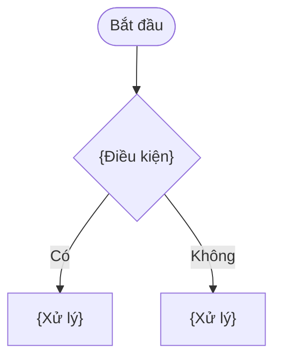

<!--
USE CASE BLOCK — written inside docs/project-srs.md as section {N} (4, 5, 6…). Sub-sections are {N}.1 … {N}.7.
One Use Case = one complete user goal in one session (see use-case-writer scoping rules), usually several screens.
Language: Vietnamese sentences, English UI / product terms, never "Tiếng Việt (English)".
Style: "Điều kiện / Hành động > Kết quả" everywhere. No meta notes, no Figma node ids, no hex colors, no pixel sizes.
Anchors: UC-local anchors are prefixed with the UC id (uc-{mod}-{nnn}-af-1); BR anchors are global (br-012).
Delete every comment and placeholder in the output.
-->

<a id="uc-{mod}-{nnn}"></a>

## {N}. Use Case: {Tên Use Case ngắn gọn}

| Thuộc tính | Giá trị |
| :--- | :--- |
| Mã UC | `UC-{MOD}-{NNN}` |
| Trigger | {1 câu: hành động / sự kiện bắt đầu Use Case} |
| Pre-condition | {1 câu: điều kiện phải đúng trước khi bắt đầu} |
| Post-condition | {1 câu: trạng thái sau khi hoàn thành} |

### {N}.1 Đặc tả giao diện

<!--
1) Screen grid: 3 images per row, caption under each image. More than 3 screens → another grid table below.
   Every designed state worth showing is its own image (e.g. a bottom sheet opened over a screen). Empty cells for a short last row.
   Screens come from the Figma analysis: BA/figma/{feature}/screens/{NN}-{slug}.png
-->

|  |  |  |
| :---: | :---: | :---: |
| **Hình 1: {Tên màn hình / trạng thái}** | **Hình 2: {Tên màn hình / trạng thái}** | **Hình 3: {Tên màn hình / trạng thái}** |

<!--
2) One element table per image, titled with the same caption.
   Thành phần = the exact UI label in backticks, then <br>, then the element image exported from Figma
   (BA/figma/{feature}/elements/{screenNN}-{NN}-{slug}.png, height 32).
   Large containers (popup, bottom sheet, dialog, whole list) get no element image: write "Xem Hình N" instead.
   No element image available (design given only as screenshots) → label only.
   Only interactive elements; never repeat a shared element already described on an earlier screen.
-->

**Hình 1: {Tên màn hình / trạng thái}**

| ID | Thành phần | Loại | Mô tả tương tác |
| :--- | :--- | :--- | :--- |
| 1 | `{Nhãn UI}`<br> | {Button / Icon button / Toggle / Text field…} | {Hành động của user} > {Phản hồi trên UI}. |
| 2 | `{Bottom sheet …}`<br>Xem Hình {N} | Bottom sheet | {Hành động} > {Phản hồi}. |

### {N}.2 User Flow

<!--
Required for every Use Case. Drawn with the user-flow skill: only "user action > what the UI does", flowchart TD, max ~15 nodes (split otherwise).
The render script adds the "Xem ảnh lớn" line under the block; do not write it by hand.
-->

<a id="uf-{mod}-{nnn}"></a>

```mermaid
flowchart TD
    S([{Điểm bắt đầu}]) --> A["{Màn hình}"]
    A -->|"{User action}"| B["{UI phản hồi / màn hình tiếp theo}"]
```

### {N}.3 Basic Flow

<!-- Note/References: links on ONE line, comma-separated: [BR-002](#br-002), [AF-1](#uc-{mod}-{nnn}-af-1). Leave empty when nothing to reference. -->

| Step | Actor | Action | Note/References |
| :--- | :--- | :--- | :--- |
| `BF-1` | User | {Hành động của user} > {Kết quả}. | |
| `BF-2` | System | {Hệ thống xử lý} > {Hiển thị kết quả}. | [BR-002](#br-002), [AF-1](#uc-{mod}-{nnn}-af-1), [EF-1](#uc-{mod}-{nnn}-ef-1) |

### {N}.4 Alternative Flow

<!-- Only when it really exists in the design / decisions; otherwise delete the whole sub-section and renumber nothing. -->

| Step | Actor | Action | Note/References |
| :--- | :--- | :--- | :--- |
| <a id="uc-{mod}-{nnn}-af-1"></a>`AF-1` | User / System | Tại `BF-2`: {Hành động rẽ nhánh} > {Kết quả và bước quay lại}. | [BR-003](#br-003) |

### {N}.5 Exceptional Flow

<!-- Only when it really exists; otherwise delete the sub-section. -->

| Step | Actor | Action | Note/References |
| :--- | :--- | :--- | :--- |
| <a id="uc-{mod}-{nnn}-ef-1"></a>`EF-1` | System | Tại `BF-2`: {Điều kiện lỗi} > Hiển thị error state (*"{Nội dung lỗi}"*). | [BR-002](#br-002) |

### {N}.6 Business Rules

<!-- Use Case specific data rules only (validation, min/max, default values, formulas, sorting). ONE rule per row; never stack rules with <br>. No UI clicks or navigation already written in {N}.1–{N}.5. -->

| STT | Rule ID | Tên rule | Mô tả |
| :--- | :--- | :--- | :--- |
| 1 | <a id="br-{nnn}"></a>`BR-{NNN}` | {Tên rule} | {Điều kiện / Ràng buộc} > {Kết quả}. |

### {N}.7 Activity Diagram

<!--
Only for a LARGE feature: 3+ screens, or several conditional branches, or payment / IAP / subscription / permissions.
Otherwise delete this sub-section. Describes business logic and decisions, not screen navigation.
-->

<a id="act-{mod}-{nnn}"></a>


