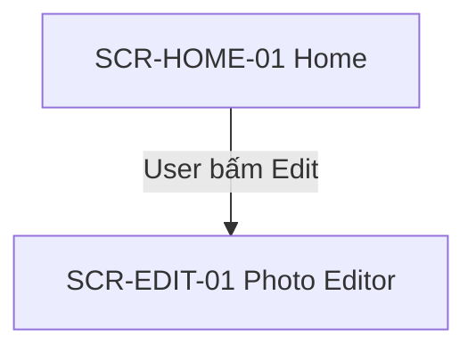
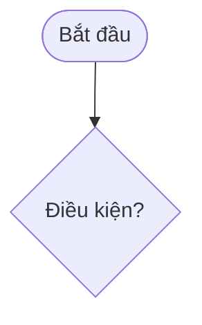

<!--
SRS TEMPLATE — ONE FILE for the whole app.
Path: docs/ba/srs/{app-slug}_srs_v{N}.md  (dev reads this .md; tester receives the .docx exported from it)
Language: Vietnamese content; keep screen names, UI names and on-screen texts as in the design.
Every Use Case is written IN FULL inside section 6 using use-case-template.md. Do not split Use Cases into separate files.
Every diagram is written as a Mermaid block INSIDE this file, preceded by an HTML anchor so Use Cases can link to it.
Remove every {placeholder}. Omit optional sections (7–10) entirely when not applicable.
-->

# Tài liệu đặc tả yêu cầu phần mềm (SRS) — {Tên app}

| Mục | Nội dung |
|---|---|
| Dự án | {Tên dự án} |
| Nền tảng | {Android / iOS / cả hai} |
| Phiên bản tài liệu | v{N} |
| Ngày cập nhật | {YYYY-MM-DD} |
| Người viết | {PO / @business-analyst} |
| Trạng thái | Nháp / Chờ audit / Đã audit / Bị chặn bởi P0 |
| App tham khảo | {Tên app đối thủ, nếu có — app tham khảo không có nghĩa là áp dụng nguyên} |

## Mục lục

<!-- Liệt kê mục 1–12 và các module trong mục 6. -->

## 1. Tổng quan sản phẩm

- **Mục đích**: {Mục tiêu sản phẩm}
- **Người dùng mục tiêu**: {Nhóm người dùng đã xác nhận}
- **Ràng buộc chính**: {Chỉ ghi điều đã xác nhận}

## 2. Phạm vi

### 2.1. Trong phạm vi

{Các nhóm tính năng / tính năng đã chốt}

### 2.2. Ngoài phạm vi

{Tính năng của app tham khảo đã chốt REMOVE, hoặc "Không có"}

### 2.3. Chưa chốt

{Mục TBD, hoặc "Không có"}

## 3. Danh sách tính năng và truy vết

**Feature Checklist**: {đường dẫn file Feature Checklist}

| Nhóm tính năng | Tính năng / Tính năng nhỏ | Mã UC | Màn hình | Trạng thái |
|---|---|---|---|---|
| {Group of feature} | {Tính năng} | [UC-{MOD}-{NNN}](#uc-{mod}-{nnn}) | SCR-{MOD}-{NN} | Trong phạm vi / TBD |

## 4. Quy tắc nghiệp vụ dùng chung

| Mã | Khi / Điều kiện | Quy tắc | Áp dụng cho |
|---|---|---|---|
| BR-{NNN} | {…} | {Quy tắc dùng cho nhiều UC} | {UC-…} |

<!-- Không có: ghi "Không có". -->

## 5. User Flow

<!-- BẮT BUỘC: mỗi nhóm tính năng chính có ít nhất một User Flow (điểm vào, màn hình, điều hướng, điểm ra). -->

### UF-{MOD}-{NNN} — {Tên hành trình}

**Use Case liên quan**: UC-{MOD}-{NNN}, …

## 6. Yêu cầu chức năng và Use Case

<!-- Lặp lại 6.x cho từng module / nhóm tính năng. Mỗi UC viết đầy đủ theo use-case-template.md, đặt ngay trong module của nó. -->

### 6.1. {Module / Nhóm tính năng}

**Mô tả module**: {Phạm vi ngắn gọn}

{Use Case đầy đủ theo use-case-template.md}

<!-- Activity Diagram của module (chỉ cho tính năng lớn) đặt ngay sau các UC nó mô tả: -->

#### ACT-{MOD}-{NNN} — {Tên quy trình}

**Use Case liên quan**: UC-{MOD}-{NNN}

<!-- Sequence Diagram: chỉ khi có tương tác phức tạp giữa app, backend, SDK hoặc dịch vụ bên ngoài đã được xác nhận. Không tự bịa API. -->

## 7. Quyền truy cập (nếu có)

| Quyền | Thời điểm xin | Mục đích | Cho phép / Từ chối | UC liên quan |
|---|---|---|---|---|

## 8. Quảng cáo / Mua trong app (nếu có)

| Hạng mục | Thời điểm kích hoạt | Hành vi | UC / Quy tắc liên quan |
|---|---|---|---|

<!-- Chỉ có mục này khi Ads/IAP thuộc phạm vi đã chốt. Không suy ra từ app tham khảo. -->

## 9. Yêu cầu phi chức năng (nếu có)

| Loại | Yêu cầu | Mức / Ràng buộc | Nguồn |
|---|---|---|---|

## 10. Phụ thuộc (nếu có)

| Phụ thuộc | Mục đích | Nguồn xác nhận | Ảnh hưởng tới |
|---|---|---|---|

## 11. Câu hỏi mở (tổng hợp)

| Mã | Tính năng / Chủ đề | Nội dung cần chốt | Ưu tiên | Người trả lời | Trạng thái |
|---|---|---|---|---|---|
| Q-{NNN} | {…} | {…} | P0/P1/P2 | {PO} | Mở |

> Còn câu hỏi P0 đang mở thì tài liệu chưa sẵn sàng bàn giao cho Dev/Tester.

## 12. Lịch sử thay đổi

| Phiên bản | Ngày | Thay đổi | Nguồn / Quyết định |
|---|---|---|---|
| v{N} | {YYYY-MM-DD} | {Tóm tắt} | {…} |
