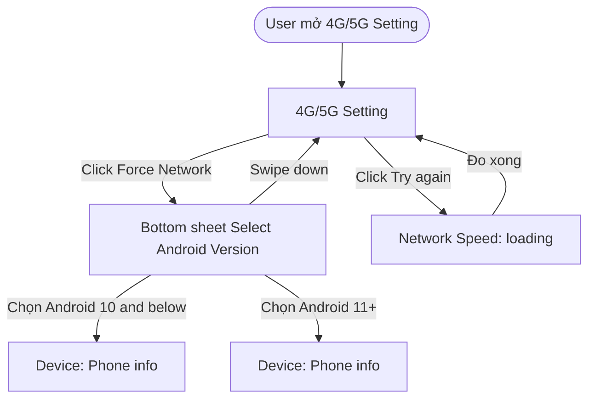

# User Flow

One Use Case = one User Flow. The diagram answers a single question:

> **When the user does this action, what does the UI do?**

It is not a business-logic diagram (that is the Activity Diagram, only for large features) and not a feature list (that is the feature tree in SRS section 2).

## 1. Drawing Rules

1. **Scope.** One diagram per Use Case, placed in `{N}.2 User Flow`, covering the Use Case from its trigger to its post-condition, including its alternative and exceptional branches when they change what the UI shows.
2. **Only user action → UI response.**
   - Nodes are what the user sees: a screen, a screen state, a popup / bottom sheet / toast / error state.
   - Edges are user actions, written as the label: `-->|"Click Save"|`.
   - A system result the user can see may be an edge label too (`-->|"Lưu thành công"|`).
   - No API calls, no database, no internal processing, no business formulas.
3. **Direction.** Always `flowchart TD` (vertical), as required by `ba-markdown-formatting`. Never `LR`.
4. **Size.** At most about **15 nodes** per diagram. Larger → split into sub-flows inside the same Use Case (`uf-edit-001-a`, `uf-edit-001-b`), each with its own anchor, and connect them with an end node such as `→ xem UF-EDIT-001-B`.
5. **Node labels.**
   - Screens: the exact screen name from the design, in quotes: `A["Photo Editor"]`.
   - States and overlays: name + state: `B["Bottom sheet Select Android Version"]`, `E["Error state: No internet"]`.
   - Start and end: rounded nodes `S(["User mở Home"])`, `X(["Kết thúc"])`.
   - Decision only when the UI branches on something the user can see or choose: `C{"Đã chọn ảnh?"}`.
   - Short labels; never Figma node ids, colors or sizes.
6. **Language.** Vietnamese sentences with English UI terms, no bilingual glosses (`ba-global-rules`).
7. **Anchor.** Put `<a id="uf-{mod}-{nnn}"></a>` on the line above the ```` ```mermaid ```` block.

## 2. Example



## 3. Render and Link (mandatory after writing or changing any diagram)

```bash
python .agents/skills/user-flow/scripts/render_diagrams.py docs/project-srs.md
```

For every Mermaid block in the file (feature tree, User Flows, Activity Diagrams) the script:

- renders `docs/BA/diagrams/{anchor-id}.svg` and `.png`;
- writes, right under the block, the line
  `[Xem ảnh lớn](BA/diagrams/uf-edit-001.svg) · [Mở trên mermaid.live](https://mermaid.live/view#pako:…)`;
- replaces that line on every run, so run it again after any edit. Never write the line by hand.

Requirements: mermaid-cli (`npm i -g @mermaid-js/mermaid-cli`). Without it the script still writes the mermaid.live link and warns. If mmdc cannot find a browser, set `PUPPETEER_EXECUTABLE_PATH` to an installed Chrome / Edge.

## 4. Check Before Handing Over

1. Every Use Case has exactly one User Flow (or a set of linked sub-flows).
2. Every edge label is a user action or a visible result; every node is something on screen.
3. ≤ ~15 nodes per diagram; `flowchart TD`; no `direction LR`.
4. The anchor id matches the Use Case id (`uf-edit-001` for `UC-EDIT-001`).
5. The render script ran and the link line exists under every diagram.

Syntax reference: `mermaidjs-v11`.
